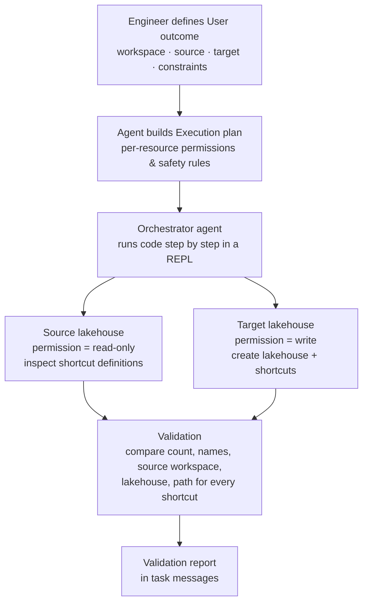
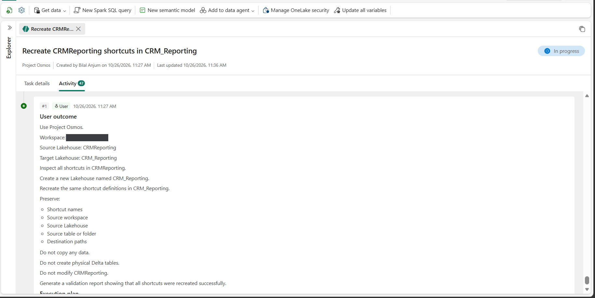
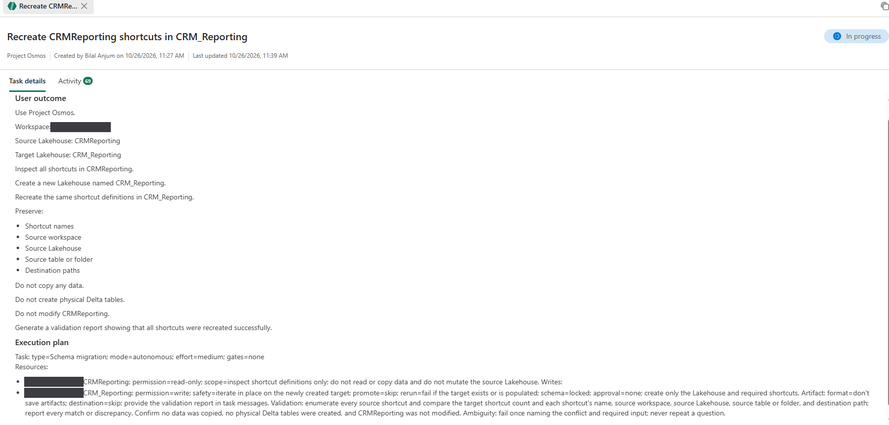
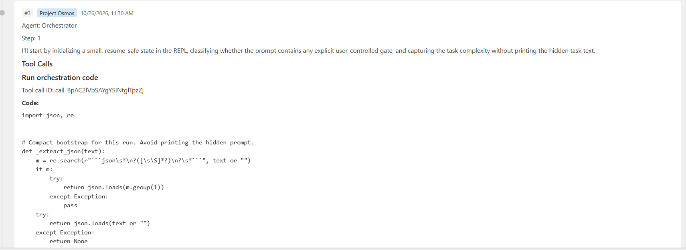

# Fabric Data Engineering Agent

> An agent-driven data engineering solution, **in active development**, that combines **Microsoft Fabric**, **Microsoft Foundry** agents and the **Fabric data engineering agent (Project Osmos)** to generate, run and validate data-engineering work inside governed Fabric workspaces.

`Microsoft Fabric` · `Fabric data engineering agent (Project Osmos)` · `Microsoft Foundry` · `Lakehouse` · `Warehouse` · `OneLake shortcuts` · `PySpark notebooks` · `Data pipelines`

**Status:** In development

---

## Overview

A lot of data-engineering time goes on repetitive work: creating lakehouses and warehouses, writing Bronze-to-Silver notebooks, wiring pipelines, recreating shortcuts and checking that everything landed correctly. This project builds a client-specific **agentic data-engineering capability** that can read, build and write within Fabric, so engineers can describe the outcome they want and let agents plan, execute and validate the work within explicit permissions.

It builds on **Project Osmos**, the autonomous data-engineering agent Microsoft brought into Fabric after acquiring Osmos in January 2026 ([Microsoft announcement](https://blogs.microsoft.com/?p=52562684)). Foundry agents add reasoning and engineering automation on top.

## Problem and goals

**Problem**
- Routine engineering tasks are repeated across many source systems and tables.
- Hand-written notebooks and pipelines vary in quality and conventions.
- Validation after changes is often manual or skipped.

**Goals**
- Generate and orchestrate standard engineering artifacts automatically.
- Keep every agent action inside governed Fabric workspaces with explicit, scoped permissions.
- Make validation part of every task.
- Move toward an **agentic data-engineering operating model**.

## Capabilities

| Capability | Status |
|---|---|
| Agent tasks in a Fabric workspace through Project Osmos, with a user-defined outcome, execution plan, per-resource permissions and a validation report | Demonstrated (see screenshots) |
| Lakehouse creation and **shortcut recreation** between lakehouses (read-only source, no data copy) | Demonstrated |
| Automated creation and management of lakehouses and warehouses | In development |
| Generation of Fabric notebooks for **Bronze → Silver** transformations | In development |
| Agent-assisted development and orchestration of data pipelines from source systems (core banking, card management, ERP and others) | Planned |
| Agent-assisted ingestion, transformation, validation and troubleshooting | Planned |
| Foundry agents for reasoning and engineering automation alongside Osmos | In development |

## How a task runs

The screenshots show a real task: *recreate the shortcuts of an existing lakehouse in a new lakehouse*.

**Guardrails expressed in the task**
- The source is **read-only**: inspect definitions only, never read or copy data, never change the source.
- The target is **write**, limited to creating the lakehouse and the required shortcuts.
- `rerun=fail` if the target already exists or is populated, and `schema=locked`.
- No data copied, no physical Delta tables created.
- If something is ambiguous, the agent fails once and states the conflict instead of guessing.
- Validation compares every source shortcut with its target and reports any match or discrepancy.

## Architecture

| Layer | Technology | Role |
|---|---|---|
| Agent runtime in Fabric | Fabric data engineering agent (Project Osmos) | Plans and runs long-running engineering tasks with scoped permissions |
| Reasoning and automation | Microsoft Foundry agents | Engineering reasoning, code generation, orchestration logic |
| Data platform | Fabric lakehouses, warehouses, OneLake shortcuts, Spark | Where artifacts are created and data is transformed |
| Interface | Fabric task UI and CLI-driven agent sessions | Submit tasks, follow activity, read validation reports |

## Business value

- **Engineering throughput:** standard artifacts are produced in minutes, not hours.
- **Quality and consistency:** generated work follows the same conventions every time.
- **Safety by design:** least-privilege permissions per resource and mandatory validation reduce the risk of agent mistakes.
- **Scalability:** onboarding new source systems becomes much more repeatable.

## Screenshots

| Task outcome and constraints | Execution plan and permissions |
|---|---|
|  |  |
| The engineer's requested outcome, with explicit "do not" rules | Per-resource permissions, safety, rerun and validation rules |

| Orchestrator agent step |
|---|
|  |
| The orchestrator agent running its first code step |

## Security and permission model

- **Per-resource permissions** are declared in the execution plan (read-only vs write).
- **Governed environment:** agents act only inside the Fabric workspaces they are given.
- **Validation is mandatory:** each task ends with a verifiable report.
- **Confidentiality:** customer, workspace and source-system details are withheld. Source systems are described generically.

## Limitations

- This is work in progress, and several capabilities above are planned or in development.
- Project Osmos is a new Microsoft capability, so its features and availability may change.

## My role

I'm designing and building the solution: defining agent tasks and guardrails, integrating Foundry agents with Fabric and Project Osmos, and testing on real engineering scenarios such as lakehouse shortcut migration.

---
Workspace names, IDs, file paths and customer details have been removed.
